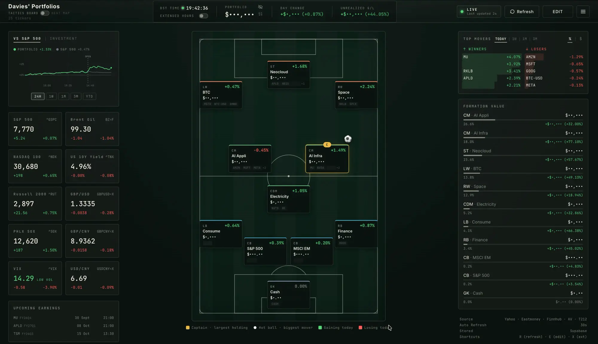
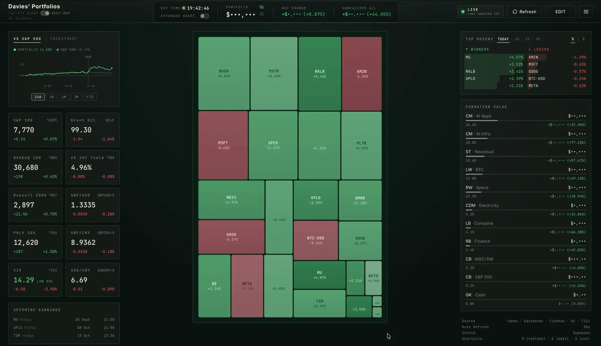
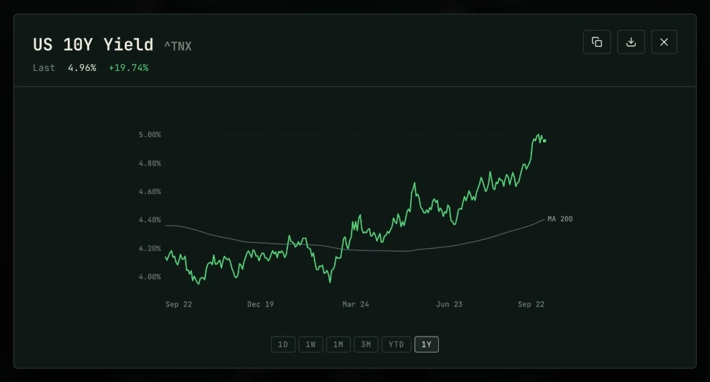
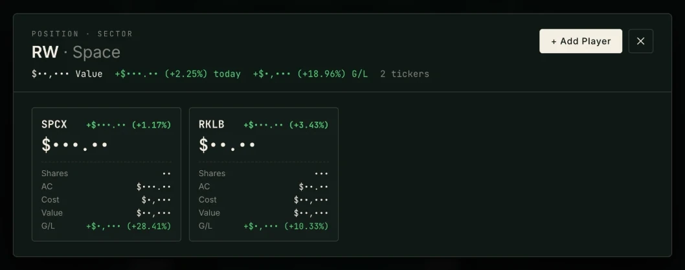
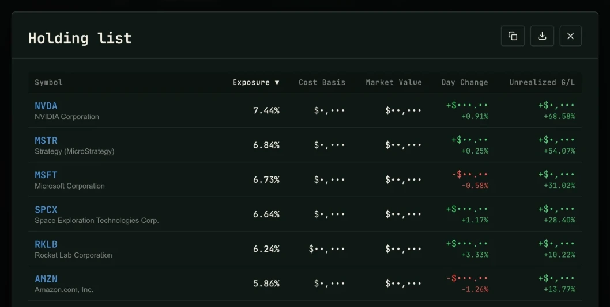
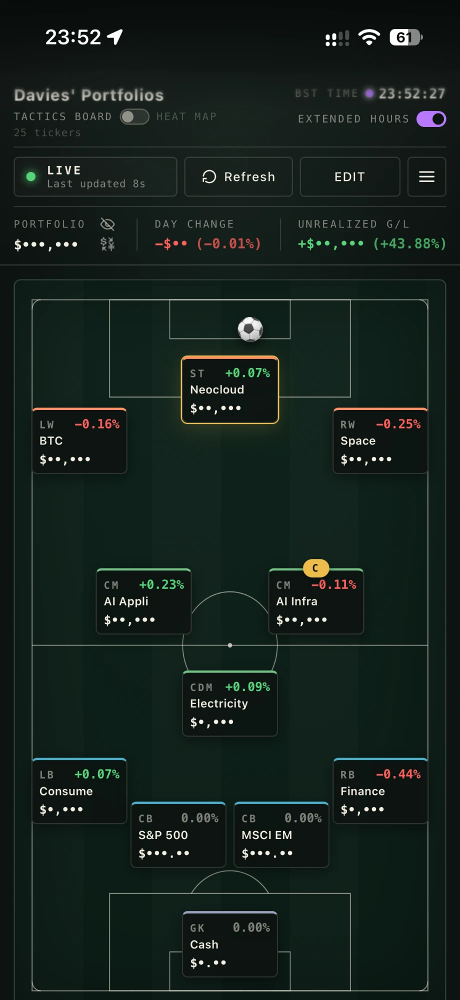
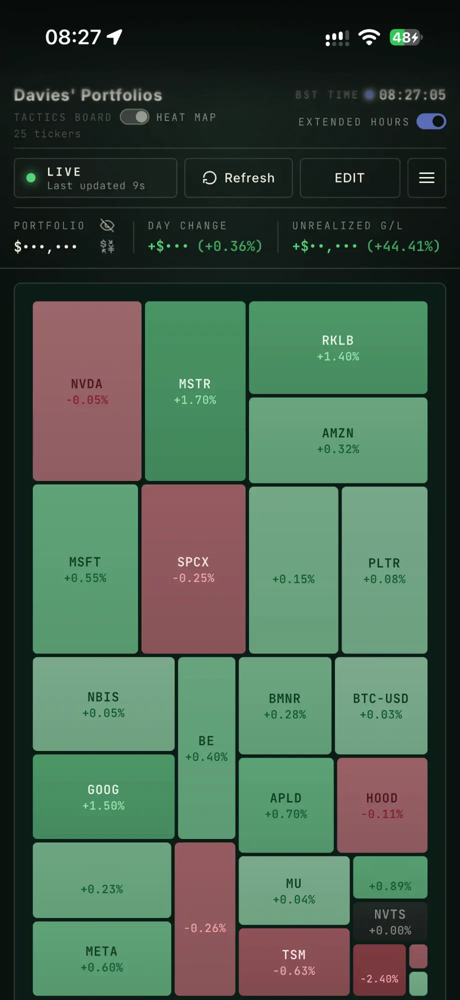
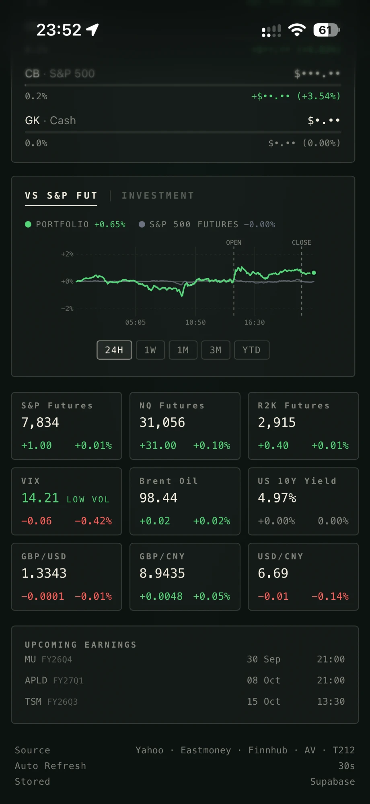

# Portfolio Tactics

[](../LICENSE)

I built this dashboard to run my own portfolio, and I use it every day.
It lays the book out as a football tactics board: each sector is a
player on the pitch. Around the board are a heat map, performance
against the S&P 500, market conditions, charts with valuation history,
analyst target prices and a transaction ledger synced from my broker.

> **Live example: [daviesluo.com](https://daviesluo.com)**
>
> This is my own instance with my real portfolio, so it needs a
> password. **Contact me, Davies, for one.**
>
> In the screenshots below every amount and share count is hidden by the
> site's hide-values switch (the eye icon next to PORTFOLIO). I built it
> so I can show the page without showing the money. Percentages, tickers
> and market data are real.

## Screenshots

Desktop and phone, 22 September 2026, amounts hidden.

**Tactics board.** Each card is a sector with its holdings, value and
today's move. The armband marks the largest single holding and the ball
sits by the day's biggest mover. Performance, market conditions and
upcoming earnings are on the left; top movers and sector weights on the
right.



| Heat map | Market chart |
|---|---|
|  |  |

- **Heat map**: one tile per holding, sized by value, coloured by today's
  move.
- **Market chart**: every card opens a chart from 1D to 1Y, with moving
  averages, VWAP, and P/E or P/S history for stocks. This one is the US
  10-year yield with its 200-day average.

| Sector drill-down | Holding list |
|---|---|
|  |  |

- **Sector drill-down**: a sector's holdings with shares, average cost,
  value and gain.
- **Holding list**: every holding, sortable, with copy and Excel export.

On a phone the page is one column: the board or the heat map first, then
the sidebar with performance, market conditions and upcoming earnings.

| Tactics board | Heat map | Sidebar |
|---|---|---|
|  |  |  |

## What it does

- **Tactics board**, the default view. Cash is in goal, index funds play
  centre-back and the thematic bets play further forward. In edit mode
  you drag one card onto another to swap two sectors.
- **Heat map** of every holding.
- **Performance vs the S&P 500** over 1D, 1W, 1M, 3M and YTD. The
  **Investment** tab shows the book's value against the money paid in.
  Prices are recorded on the server every five minutes, and any stretch
  that had to be rebuilt is drawn faded.
- **Market conditions**: the major US indices, VIX, the 10-year yield,
  Brent and three FX pairs. An extended-hours switch moves the indices to
  their futures.
- **Charts** for every holding and market card, including a real
  overnight line for US stocks built from recorded broker quotes. Any
  chart can be copied or saved as an image.
- **Target price**: for every holding, the analysts' average target and
  rating, their range, how many there are and which targets changed in
  the last month, the average target against the live price, and a few
  short notes on the risks. A server job refreshes it before, at and
  after each US session; funds are scored through their largest holdings.
- **The ledger**: buy lots, sales and dividends per holding, cost basis
  and realised gain across USD, GBP, EUR, CNY and HKD with live FX, and
  Chinese mutual funds priced from Eastmoney.
- **Trading 212 sync** of positions and every fill, without touching
  shares of the same ticker held at another broker.
- **Two passwords**: one that can edit and a read-only one for sharing,
  both checked on the server.
- **Installs as an app** on iOS and Android, works offline, and tells you
  when a new version is out.

The live site also has an Agents page, where I run my own trading
experiments. That part is private and is not in this repository. The
code here has a small stub in its place, so the app still builds and
runs without it.

## How it's built

![Architecture. The user opens daviesluo.com and signs in once with a
password, which the auth function exchanges for a signed token. The
browser, a React 19 PWA served by Cloudflare Pages, paints from its own
cache first and then sends requests carrying that token to Supabase Edge
Functions written in Deno: auth, data, prices, chart, fundamentals,
trading212, overnight-fetch and targets. Separately, pg_cron calls
scheduled Edge Functions with no browser open: snapshot-record every five
minutes, overnight-record every five minutes through the US overnight
session, the Trading 212 sync and the analyst targets. Both kinds of
function read and write Postgres, which keeps the portfolio, five-minute
prices, overnight quotes, broker fills, error reports and analyst
targets. Outside services — Yahoo Finance, Eastmoney, Finnhub, Alpha
Vantage and Trading 212 — are called from the server, where every key
stays.](architecture.svg)

The page and the scheduled jobs share one database, so prices keep being
recorded when nobody has the page open.

| Layer | What I used |
|---|---|
| Client | React 19 and Vite. Plain JSX, type-checked by `tsc`. Four runtime dependencies. Charts are hand-written SVG. |
| Server | Supabase Edge Functions on Deno. Every key lives here; the browser only holds a short-lived signed token. |
| Data | Postgres. CI applies the migrations. |
| Scheduling | `pg_cron` calls the recorders through `pg_net`. |
| Hosting | Cloudflare Pages serves the built bundle. |
| CI/CD | GitHub Actions: gates on every push, Edge Functions deployed when they change, migrations applied when they reach `main`. |

## How I work on it

- **Every push runs the same gates**: type-check, lint, unit tests, a
  production build, browser tests, a bundle-size budget, a dead-code
  scan and a dependency audit.
- **Three levels of tests**: unit tests (Vitest), Edge Function tests
  (Deno), and browser runs against the real production bundle in
  Chromium. One of them checks the performance panel in 76 cases
  against answers worked out by hand.
- **Every bug fix comes with a test that fails on the old code.** When it
  matters I revert the fix and watch the test fail again.
- **Numbers are checked against arithmetic, not against the app.** Test
  data is built so the right answer can be worked out by hand.
- **One function per number.** The performance chart, the investment
  chart and top movers all use the same valuation code. Two separate
  versions of it once drifted apart and put two different numbers on
  one screen.
- **Errors are recorded.** Client and server errors go into a table, and
  an admin badge in the header groups the last 24 hours.

## About this repository

I develop the site in a private repository. This one is a public copy
of everything except the Agents part, with its history, updated on
every push. Commit messages about private work read "Update …" here,
and some figures from my own account are written `[•]`.

## Repository map

| Path | What's there |
|---|---|
| `src/` | The web app, an npm project of its own, in folders by what each part does: `app/` (startup, sign-in, shared styles), `portfolio/`, `prices/`, `charts/`, `board/` (the home page) and `tables/`, with each file's tests beside it. `agents/` is the stub. |
| `src/e2e/` | The browser test of the performance panel. |
| `src/public/` | Static files copied into the build: Cloudflare's `_headers` and `robots.txt`. |
| `supabase/functions/` | The Edge Functions: `auth`, `data`, `prices`, `chart`, `fundamentals`, `trading212`, `overnight-fetch`, `overnight-record`, `snapshot-record` and `targets`, plus `_shared/`. Each has its tests beside it. |
| `supabase/migrations/` | The portfolio's database schema. |
| `docs/` | This page, its screenshots and the diagram. |

## Run it locally

```sh
cd src
npm ci
npm run build           # the bundle, into ../dist (one test reads its service worker)
npm test                # the unit tests
npm run dev             # http://localhost:5173
```

The client talks to my production Supabase project, so the board needs
one of the two passwords. To run your own copy, create a Supabase
project, apply the migrations, deploy the Edge Functions with their
secrets, and point `src/app/supabase_config.js` at it.

## License

MIT, see [LICENSE](../LICENSE).
